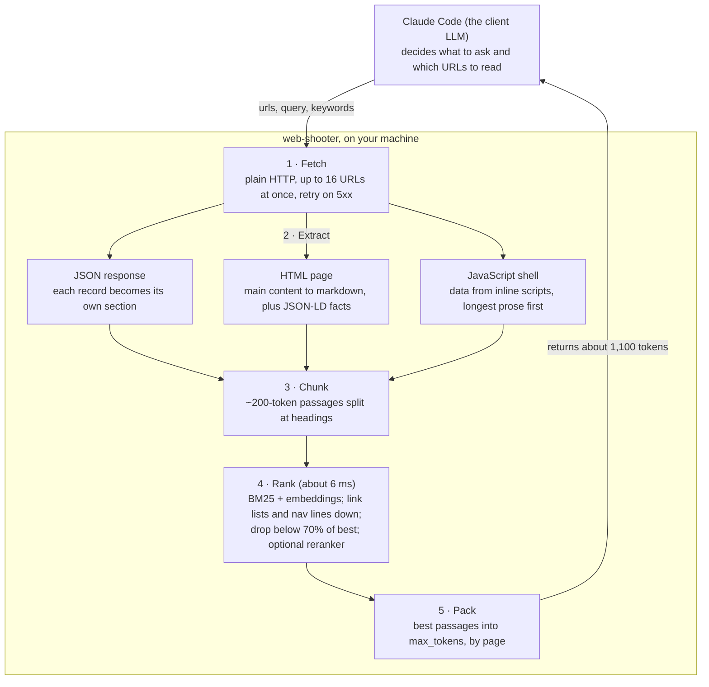

# How web-shooter works

Last updated 2026-10-11. Setup instructions are in the [README](../README.md); the design decisions behind each part are in [CLAUDE.md](../CLAUDE.md).

## Overview

web-shooter is a local MCP server, written in Rust, that lets an AI assistant read the web fast and with few tokens: it returns only the passages or pages relevant to what the assistant asked, not whole pages. On our test set it answers in a median of 405 ms with about 1,100 tokens, where Firecrawl and Jina Reader return about 16,000 tokens per page.

The key design choice: there is no language model inside the server. The assistant that calls it (for example Claude Code) already decides what to look for and which URLs to read. web-shooter does the cheap, fast work in between: fetching, cleaning, ranking and trimming. Ranking runs locally on the CPU in milliseconds, so it costs no tokens.

It runs on your own machine as one binary. Claude Code starts it when a session opens and talks to it over standard input and output (stdio).

## The three tools

The assistant sees three tools. Each returns compact markdown text, not JSON, because JSON quoting wastes tokens.

| Tool | Use it when | Parameters | Returns |
| --- | --- | --- | --- |
| `fetch` | You have URLs and want their content | `urls` (several per call), `query`, `keywords`, `max_tokens` (default 2,000), `precise` | With a query: the best passages, grouped by page. Without: whole pages, trimmed to the budget |
| `links` | You want to pick which page to read next | `url`, `query`, `keywords`, `max_links` (default 30) | The page's links, ranked by the query if given |
| `crawl` | You have a start page and a goal, but not the URLs | `url`, `query`, `keywords`, `max_pages` (30), `max_depth` (3), `other_sites`, `max_results` (10) | The most relevant pages found, as URLs with a one-line snippet each |

A `fetch` with a query looks like this. One line per page, then `§ Heading path · score` before each passage:

```
[1] https://en.wikipedia.org/wiki/Web_crawler · Web crawler - Wikipedia
§ Crawling policy > Re-visit policy · 1.00
Two simple re-visiting policies were studied by Cho and Garcia-Molina: …
sections: Nomenclature · Overview · Crawling policy · Architectures · …
```

The `sections:` line appears when part of the page was left out, so the assistant can ask for another section. A `crawl` result lists `[n] url · title · score` with an indented snippet. The assistant then calls `fetch` on the pages it wants.

## How a fetch call works



Only step 4 uses the query; without one, steps 3 and 4 are skipped and whole pages are trimmed to the budget instead. Extraction takes 6–22 ms per page and ranking about 6 ms, so almost all of a call's time is the network.

## How a crawl works

`crawl` follows the most promising links first instead of every link in order, so it finds relevant pages after 15–30 fetches instead of thousands. On the Rust blog it found five Cargo security advisories from 16 pages in 0.2–1.7 s.

1. **Start** with the given page in a priority queue (the frontier).
2. **Fetch** the best four candidates at once. Four in flight is also the politeness limit for the site.
3. **Score each page** by its best passage, on a fixed 0–1 scale so pages can be compared across the crawl.
4. **Score each new link** by its anchor text, the heading it sits under and the words in its URL. Its priority is 0.7 × that score + 0.3 × the score of the page it was found on, because relevant pages tend to link to relevant pages.
5. **Repeat** until a stopping rule fires.

It stops at `max_pages` (default 30, at most 200), after 30 seconds, or after 12 pages in a row that don't improve the current top results.

Rules it follows:

- **robots.txt** is checked for every page the crawl discovers. The start page is exempt because the assistant asked for it by name, as with `fetch`.
- **Same site** by default; `other_sites: true` lets it leave.
- **No thin pages in results.** Pages that are mostly links (indexes, “What links here” pages) are still used to find links, but not returned.
- **No duplicates.** The same page under two URLs is caught by its canonical URL, then by a hash of its content.

The final ranking re-scores every passage from every crawled page together, then lists each page once with its best passage as the snippet.

## Ranking

Ranking combines keyword matching with meaning matching and takes about 6 ms per query. On the 15 original test cases it put the right passage first 14 times, against 11 for keyword matching alone.

| Stage | What it does | Why |
| --- | --- | --- |
| BM25 | Scores passages by shared words, with stemming (“crawlers” matches “crawler”) and hyphen joining (“re-visit” matches “revisit”) | Catches exact names, numbers and error codes |
| Static embeddings | Compares the meaning of the query and each passage with `potion-retrieval-32M`, a small model that runs in microseconds per passage | Catches paraphrases (“salary” vs “compensation”) |
| Fusion | Both scores scaled to 0–1, then 0.3 × keyword + 0.7 × meaning | Rank-based fusion (RRF) ranked as well but made every score look alike, so replies filled the whole budget |
| Shape penalties | Halves the score of link lists (3+ links, little other text) and of very short passages (6 words or fewer) | Sidebars of “other jobs” and “Back to search” lines matched queries without answering them |
| Cut-off | Drops passages below 70% of the best score | Keeps replies short; the assistant can ask again with other words |
| Reranker (opt-in) | `precise: true` rescores the top 6 with a cross-encoder (Jina reranker v2) that reads query and passage together | About 33% fewer tokens, but no better at ranking on our tests and about 300 ms slower, so it is off by default |

Passing `keywords` (exact terms or synonyms) costs the assistant almost nothing and helps most when the answer has no words in common with the question.

## Reading difficult pages

web-shooter reads three kinds of content without a browser: text in the HTML, data embedded in a page's scripts, and JSON from APIs. It cannot run JavaScript, so pages that fetch their content after loading still come back empty.

- **JSON APIs.** If a URL returns JSON, each record (for example each job) becomes its own section, with short fields on one line and long text as paragraphs. Ranking can then pick out just the matching records.
- **JavaScript-shell pages.** If a page has almost no visible text, web-shooter searches its inline scripts for data: JSON blocks, `window.x = {…}` assignments and `JSON.parse('…')` strings. Data with the most real sentences goes first, so content beats config such as font lists.
- **Noise removed on the way:** asset manifests, MathML formulas, icon-font names such as “place” or “arrow\_back”, citation markers and edit links.

Results from the first real use, a job search on 2026-10-11:

| Site | Result | Why |
| --- | --- | --- |
| Amazon and Google job postings | Works | Text is in the HTML |
| OnebyZero (Zoho Recruit) | Works | Job record embedded in a `JSON.parse` string |
| Amazon `search.json` | Works | JSON API, 163 jobs; use a query, since the whole response is about 68,000 tokens |
| Stanford, Uber (Oracle HCM) | Fails | Content loaded from a separate API by JavaScript; Uber also uses a Cloudflare bot check |
| Atlassian, Amazon search page | Fails | Results loaded by JavaScript after the page arrives |

For the failing sites, the assistant can pass the site's JSON API URL to `fetch` if it knows it, or use a real browser. A built-in headless Chrome fallback is proposed (see the last section).

## Performance

On the same 15 queries, web-shooter answered about 3× faster than Firecrawl and returned about 93% fewer tokens than Firecrawl or Jina Reader. It found the answer in 14 of 15 cases; the other two tools always “found” it because they return the whole page.

| Tool | Median latency | Avg tokens returned | Answer present |
| --- | --- | --- | --- |
| web-shooter `fetch` with a query | 405 ms | 1,138 | 14/15 |
| Jina Reader | 625 ms | 15,692 | 15/15 |
| Firecrawl, cache allowed | 1,214 ms | 16,513 | 15/15 |
| Firecrawl, fresh fetch | 3,341 ms | 16,523 | 15/15 |

The test set has since grown to 19 cases, 4 of them from real use; 17 pass. Ranking takes about 6 ms and extraction 6–22 ms per page, so nearly all the time is the network.

Caveats on these numbers:

- The ranking settings were tuned on these same cases, so the answer rate on new questions is likely lower.
- It was a single run; slow sites skew it (paulgraham.com took 0.9–6 s).
- None of these pages needed JavaScript or had bot protection, which is where Firecrawl and Jina are strongest.
- `crawl` has not been compared with Firecrawl's crawl yet.

## Data handling

web-shooter keeps no web data. A page exists only in memory during the one tool call that fetched it, and nothing is written to disk.

- **After each call:** the page's HTML, markdown, passages and scores are freed as soon as the answer is returned. Nothing carries over to the next call.
- **During a session:** only the HTTP connection pool and the ranking models stay in memory. Neither contains page content.
- **When the session ends:** Claude Code closes the server's input, the process exits immediately, and the operating system reclaims its memory.

Copies that exist outside web-shooter:

- The passages it returns become part of the Claude Code conversation, which Claude Code saves in its own history.
- The ranking models (about 130 MB, plus 1.1 GB for the optional reranker) are cached in `~/.cache/huggingface`. They contain no web data.

Freed memory is released for reuse, not overwritten. If that matters for sensitive pages, page buffers can be wiped explicitly after each call at a small speed cost. A future page cache (milestone M5) would change this picture and needs agreement first, with expiry, a size cap and an off switch.

## Setup and usage

Full setup steps, including other MCP clients, are in the [README](../README.md#setup). In short:

1. Build the release binary: `cargo build --release`
2. Register it: `claude mcp add --scope user web-shooter -- /absolute/path/to/target/release/web-shooter`
3. Start a new session, or reconnect with `/mcp`. Run this again after every rebuild, because open sessions keep the old binary.

The first query downloads the embedding model (about 30 seconds, once). The reranker downloads on the first `precise` call.

Example prompts:

- “Use web-shooter `crawl` on https://jobs.lever.co/acme with the query ‘backend engineer, Rust or Go, remote’, then `fetch` the top 3 with the query ‘requirements and salary’.”
- “Use web-shooter `fetch` on these 5 posting URLs with the query ‘visa sponsorship, location, years of experience’.”
- “Use web-shooter `links` on this careers page with the query ‘machine learning roles’.”

Tools for working on web-shooter itself:

| Command | What it shows |
| --- | --- |
| `cargo run --release --example eval` | Test-set results: answer found, answer ranked first, tokens, time |
| `cargo run --release --example probe -- <url> final` | The markdown web-shooter extracts from one page |
| `cargo run --release --example probe -- <url> rank "<query>"` | The top 8 passages for a query, with scores |
| `FIRECRAWL_API_KEY=… cargo run --release --example bench` | The benchmark against Firecrawl and Jina (uses about 14 Firecrawl credits) |
| `claude mcp remove --scope user web-shooter` | Unregisters it; code, binary and models stay |

## Limitations and roadmap

The biggest gap is JavaScript: four of the sites that failed in real use need a browser. A built-in headless Chrome fallback is the proposed next step, ahead of PDF support.

| Next | What it adds | Status |
| --- | --- | --- |
| Chrome fallback | Renders a page in headless Chrome only when plain HTTP returns an empty shell, then ranks it like any other page. About 1–5 s per such page | Proposed next; not yet agreed |
| Held-out test cases | Cases never used for tuning, ideally from real queries, for an honest accuracy number | In progress |
| Crawl benchmark | `crawl` compared with Firecrawl's crawl | Waiting for agreement to spend Firecrawl credits |
| PDF support | Reading research papers and other PDFs | Planned |
| Page cache | Instant repeat fetches, stored in SQLite | Planned last; needs expiry, a size cap and an off switch |

Known ranking gap: a vague question can miss a fact that has no label on the page. Asking “job location” missed “Google Bengaluru, Karnataka, India”; passing the city as a keyword finds it.

The alternative to the Chrome fallback is to leave those sites to Claude in Chrome. That needs no work, but returns whole pages and drives your real browser, so it is slower and costs many more tokens.
